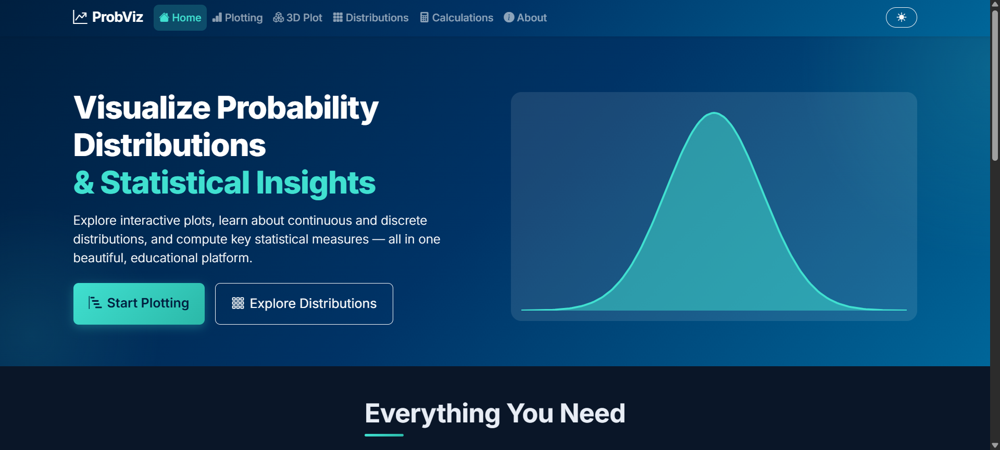

<div align="center">





\# 📊 Probability Visualizer


\*\*Making Probability and Statistics More Visual.\*\*


</div>


\# 📊 Probability Visualizer


یک ابزار تعاملی برای یادگیری، بررسی و انجام محاسبات احتمال و آمار مهندسی با استفاده از Python و Django.


این پروژه با هدف ساده‌تر کردن درک مفاهیم آماری و احتمالاتی، ارائه محاسبات و نمایش بصری توزیع‌ها و نمودارهای آماری توسعه داده شده است.


\## ✨ امکانات پروژه


\- نمایش و بررسی توزیع‌های احتمالی

\- انجام محاسبات آماری و احتمالاتی

\- رسم نمودارهای آماری تعاملی

\- نمایش نمودارهای سه‌بعدی (3D Plotting)

\- محیط کاربری تحت وب

\- استفاده از Plotly برای نمایش نمودارها

\- ذخیره اطلاعات به‌صورت محلی با SQLite


\## 🛠️ تکنولوژی‌های استفاده‌شده


| Technology | Description |

|---|---|

| Python | Core Programming Language |

| Django | Web Framework |

| NumPy | Numerical Computing |

| SciPy | Scientific Computing |

| Pandas | Data Analysis |

| Plotly | Interactive Visualization |

| SQLite | Local Database |


\## 💻 پیش‌نیازها


برای اجرای پروژه به موارد زیر نیاز دارید:


\- Windows 10 یا Windows 11

\- Python 3.11 یا بالاتر

\- مرورگر وب مانند Chrome یا Edge

\- اتصال اینترنت برای نصب اولیه کتابخانه‌ها


\## 📥 دریافت پروژه


ابتدا Repository را از GitHub دریافت کنید.


```bash

git clone https://github.com/aliesnatwelve-droid/probability\_vis.git

```


سپس وارد پوشه پروژه شوید:


```bash

cd probability\_vis

```


همچنین می‌توانید از قسمت \*\*Code → Download ZIP\*\* پروژه را به‌صورت مستقیم دانلود کنید.


\## ⚙️ نصب و راه‌اندازی


\### 1. نصب کتابخانه‌های موردنیاز


در ترمینال و داخل پوشه پروژه دستور زیر را اجرا کنید:


```bash

python -m pip install -r requirements.txt

```


\### 2. آماده‌سازی دیتابیس


```bash

python manage.py migrate

```


\### 3. اجرای پروژه


```bash

python manage.py runserver

```


\### 4. ورود به برنامه


پس از اجرای موفق پروژه، آدرس زیر را در مرورگر باز کنید:


```text

http://127.0.0.1:8000

```


اکنون می‌توانید از امکانات Probability Visualizer استفاده کنید.


\## 📈 بخش‌های اصلی برنامه


\### Probability Distributions

بررسی و مشاهده توزیع‌های احتمالی و ویژگی‌های آماری آن‌ها.


\### Calculations

انجام محاسبات مرتبط با احتمال و آمار.


\### Plotting

رسم و بررسی نمودارهای آماری و تعاملی.


\### 3D Plotting

نمایش و بررسی نمودارهای سه‌بعدی.


\## 🗄️ مدیریت اطلاعات


پروژه به‌صورت پیش‌فرض از SQLite استفاده می‌کند. دیتابیس هر کاربر به‌صورت محلی در فایل `db.sqlite3` ایجاد می‌شود.


اطلاعات دیتابیس کاربران در Repository قرار نمی‌گیرد.


\## ⏹️ توقف و اجرای مجدد


برای متوقف کردن برنامه، در ترمینال کلیدهای `Ctrl + C` را فشار دهید.


برای اجرای مجدد، کافی است دستور زیر را در پوشه پروژه وارد کنید:


```bash

python manage.py runserver

```


\## 📁 ساختار پروژه


```text

probability\_vis/

│

├── config/

│   ├── settings.py

│   ├── urls.py

│   ├── asgi.py

│   └── wsgi.py

│

├── visualizer/

│   ├── migrations/

│   ├── static/

│   ├── templates/

│   ├── stats\_engine.py

│   ├── views.py

│   ├── urls.py

│   └── models.py

│

├── manage.py

├── requirements.txt

├── test\_import.py

└── .gitignore

```


\## 🌐 Repository


GitHub: \[Probability Visualizer](https://github.com/aliesnatwelve-droid/probability\_vis)


\## 📝 License


This project is available for educational and personal use.


\---


\*\*Probability Visualizer — Making Probability and Statistics More Visual.\*\*

